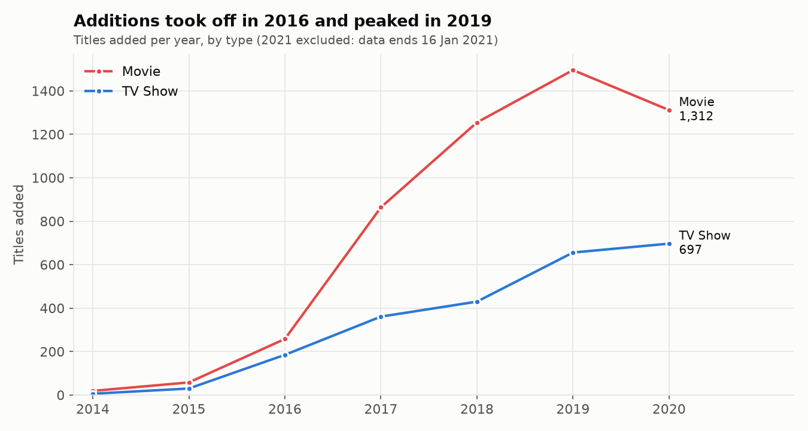
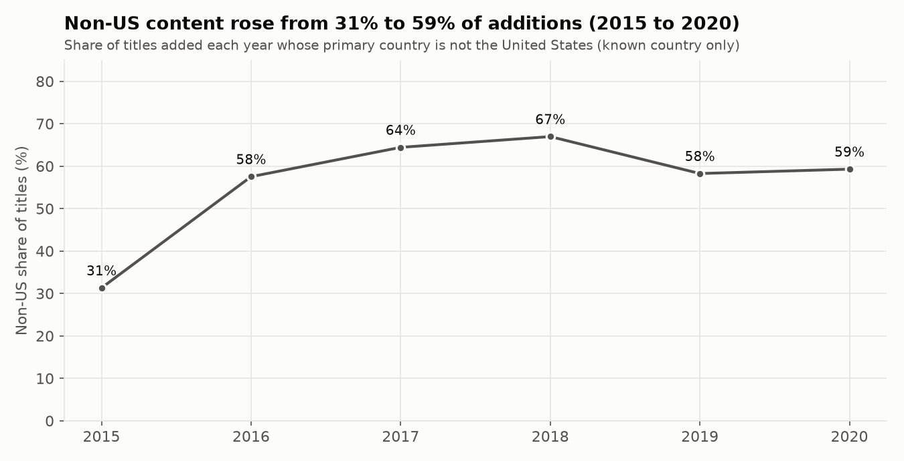
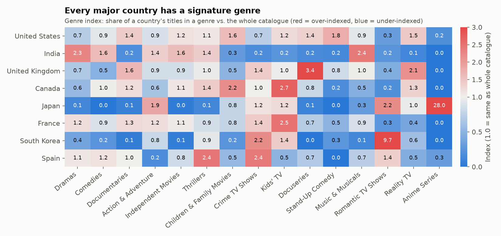

# Netflix Content Analytics


Analysis of Netflix's content catalogue (7,786 movies and TV shows) that asks how the catalogue is composed, how it changed over time, and what a content-strategy team could investigate next. It includes a tested Python package, a written analysis notebook, and an interactive Streamlit dashboard.

> **Scope note.** The dataset has no viewership data. Findings describe what was *in* the catalogue, not what people watched.

## What I found

| Question | Finding |
|---|---|
| How international is the catalogue? | The non-US share of new additions rose from **28%** (2013-2015) to **63%** (2017-2019), a significant shift (chi-square, p < 0.001). |
| Where does content come from? | United States (2,883 titles), India (956), United Kingdom (577). |
| Are new additions current releases? | 82% of titles added in 2015 were released within a year; since 2018 it is about **54%**. |
| Who is it for? | Kids' content fell from 27% of additions (2015) to 8% (2018-2019), then recovered to 13% (2020). Adult-rated titles are the largest group at 45%. |
| Do countries specialise? | Yes. South Korea: Romantic TV Shows (38% of its titles vs 3.9% overall). Japan: Anime Features (23% vs 0.8%). UK: Docuseries (15% vs 4.3%). |
| Are movies changing? | Median runtime fell from 106 min (2008 releases) to 94 min (2020). The trend is significant but weak (Spearman rho = -0.18). |
| Is it seasonal? | October to December are the busiest months for additions (about 170-176 titles a month) and February the quietest (112). |
| How concentrated is talent? | Very fragmented: 4,478 directors, 81% directed a single title, and the top 10 account for 2.3% of credits. |

Full write-up with every figure: [`reports/insights.md`](reports/insights.md) and the [notebook](notebooks/netflix_eda.ipynb).





## Dashboard

```bash
streamlit run streamlit_app.py
```

Filter by type, year added, country, audience and genre. Tabs cover growth, geography, genres, audience and format, talent, and a data and method page with a CSV download.

## Data quality decisions

- **Missing values are never filled with the most common value.** An earlier version of this project filled missing countries with "United States", which would have added 507 titles (about 18%) to the US count. Missing values are now labelled `Unknown` and excluded from country charts.
- **1 exact duplicate removed** (7,787 to 7,786 titles).
- **The incomplete final year (2021) is excluded** from trends, since the data ends on 16 January 2021.
- **Geography tags are not treated as genres.** "International Movies", "British TV Shows" and similar tags describe origin, so they are excluded from country-by-genre comparisons.
- Genre index = share of a country's titles in a genre divided by the share across the catalogue (1.0 = average).

## Limitations

- No viewership data, so "top" means "most titles".
- A snapshot: titles removed from the catalogue before it was taken are missing (survivorship bias).
- Only the first listed country is used, so co-productions count once.
- 6.5% of titles have no country and 30.7% have no director.

## Project structure

```
netflix-content-analytics/
├── data/netflix_titles.csv
├── netflix_analytics/        # cleaning, analysis, figures, theme
├── notebooks/netflix_eda.ipynb
├── reports/                  # generated insights and figures
├── tests/                    # 33 tests (cleaning, analysis, dashboard)
├── streamlit_app.py          # interactive dashboard
├── run_analysis.py           # regenerates reports/
└── .github/workflows/ci.yml  # tests on Python 3.11, 3.12, 3.13
```

## Run it

```bash
pip install -r requirements-dev.txt
python run_analysis.py        # writes reports/insights.md and reports/figures/
streamlit run streamlit_app.py
pytest                        # 33 tests
```

## Tech stack

Python, pandas, SciPy, Matplotlib, Plotly, Streamlit, pytest, GitHub Actions.

## Data

Netflix Movies and TV Shows dataset (public, originally published on Kaggle by Shivam Bansal). Check the original source's terms before reusing the data.

## Author

Pooja Jharani - [GitHub](https://github.com/pooja-jharani) | [LinkedIn](https://www.linkedin.com/in/pooja-jharani-636712367)
